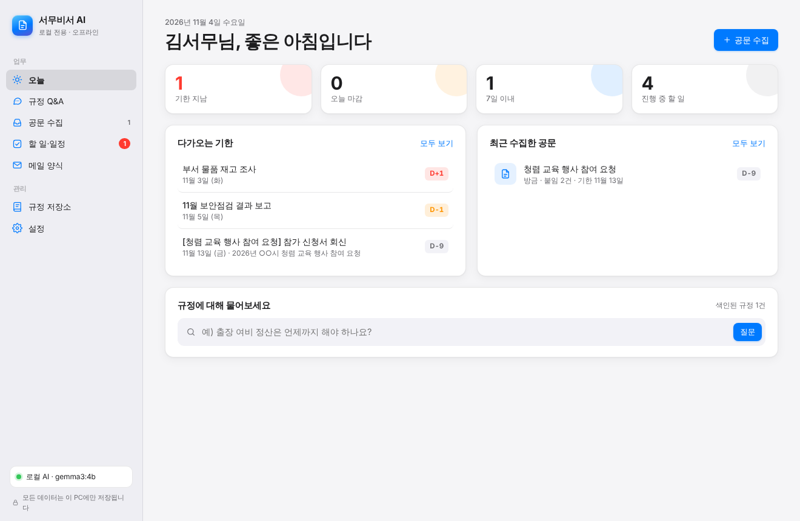
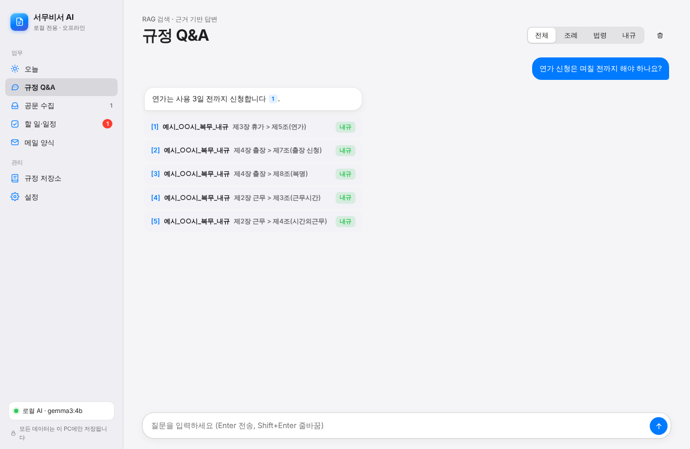
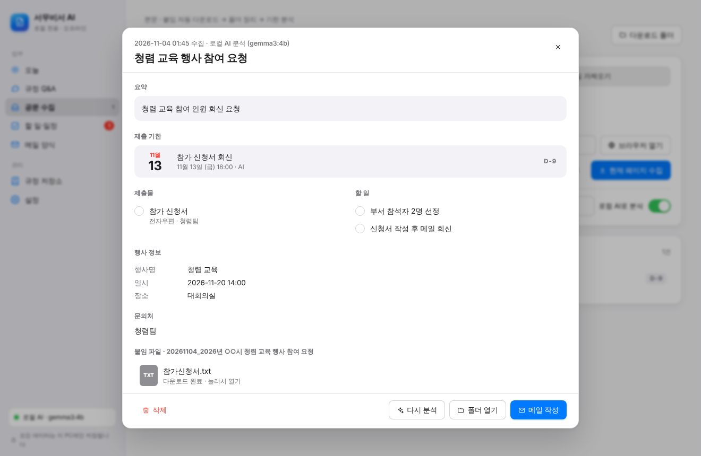
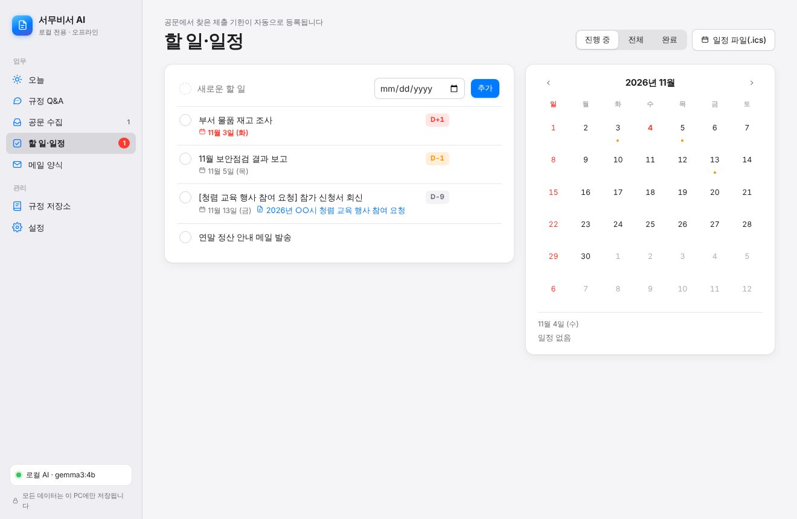
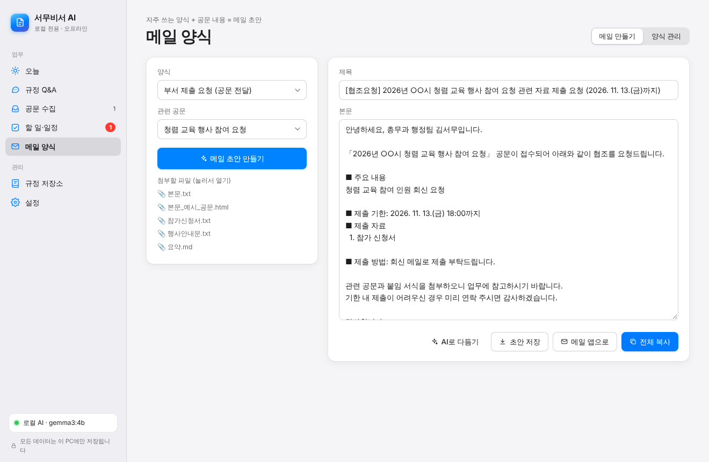
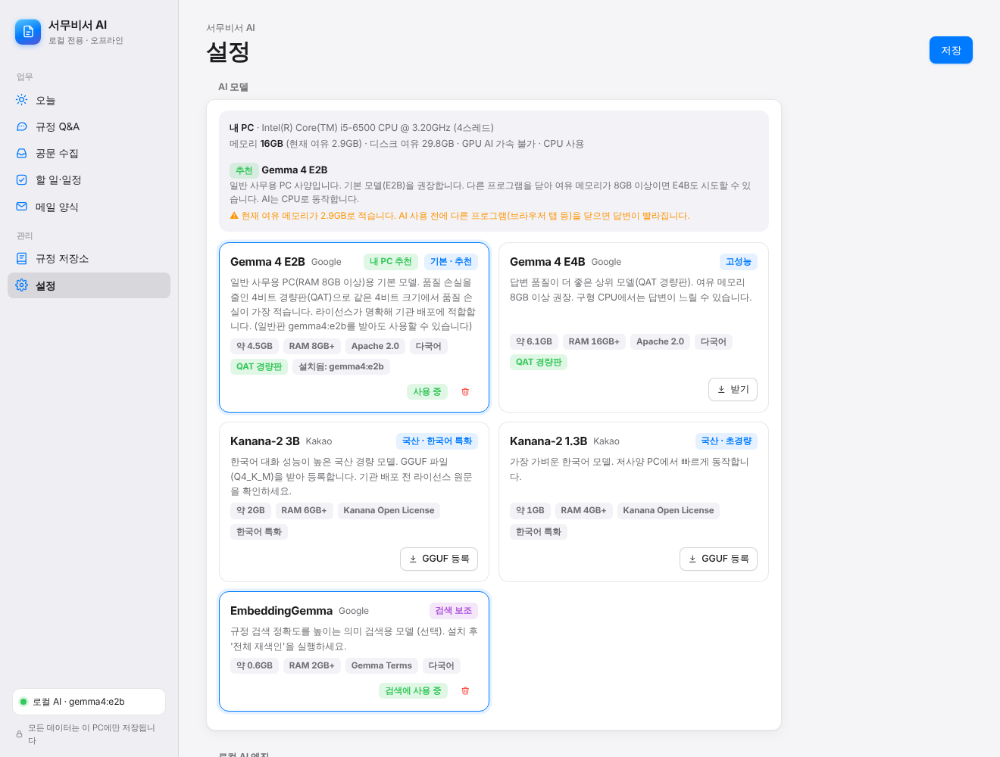
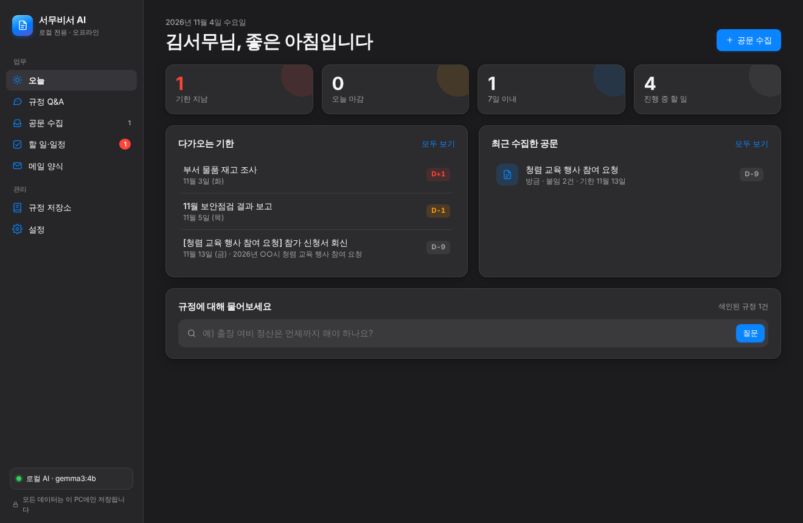

# 서무비서 AI

**내 PC 안에서만 동작하는 경량 AI 서무 보조 프로그램**

서무비서 AI는 사무용 PC에서 돌아가는 경량 AI 모델(Gemma 계열)을 내장해 쓰는 데스크톱 프로그램입니다.
조례·법령·내규를 근거로 질문에 답하고, 공문 페이지를 지정하면 본문과 붙임 문서를 내려받아 폴더로 정리한 뒤
**언제까지, 무엇을 제출해야 하는지** 정리해 줍니다. 자주 쓰는 메일 양식에 공문 내용을 채워 메일 초안도 만들어 줍니다.

모든 문서, 색인, 대화 기록, 분석 결과는 **이 PC 안에만** 저장되고 외부 AI 서비스로 전송되지 않습니다.

<p align="center"></p>

---

## 주요 기능

### 1. 규정 Q&A (RAG 검색)


- 조례·법령·내규 파일(HWP, HWPX, PDF, DOCX, XLSX, TXT, HTML)을 저장소 폴더에 넣으면 자동으로 색인합니다.
- 문서를 **조문(제N조) 단위**로 나누고 장 제목까지 함께 기억해 "「○○ 내규」 제4장 출장 > 제8조(복명)"처럼 근거를 정확하게 보여 줍니다.
- 한국어 조사 변화에 강한 키워드 검색(BM25)을 기본으로 쓰고, 로컬 임베딩 모델(bge-m3 등)이 있으면 의미 검색을 함께 씁니다(하이브리드 검색).
- 답변 문장마다 근거 번호 `[1]`을 달고, 번호를 누르면 해당 조문 원문이 펼쳐집니다. 근거가 없으면 추측하지 않습니다.
- 조례 / 법령 / 내규별로 검색 범위를 좁힐 수 있습니다.

### 2. 공문 수집, 붙임 자동 다운로드, 기한 분석


| 수집 방식 | 설명 |
|---|---|
| **열린 창에서 수집** | 전자문서 뷰어·한글·브라우저 등 **지금 열려 있는 창 목록**에서 공문 창을 고르면, 뷰어의 '본문복사' 버튼(안 되면 화면 글자 읽기, Ctrl+A/C)으로 본문을 읽고 'PC저장' 버튼으로 붙임 저장을 시도합니다. 사용자가 직접 저장한 붙임파일도 다운로드·바탕화면·문서 폴더를 감시해 공문 폴더로 자동 정리합니다. (Windows) |
| **브라우저 연동** | 프로그램이 띄운 전용 브라우저(Edge/Chrome)에서 업무포털에 로그인하고 공문을 연 뒤 **[현재 페이지 수집]**을 누릅니다. iframe 안의 본문까지 읽고, 로그인 상태를 유지한 채 붙임파일을 내려받습니다. 스크립트 방식 다운로드 버튼도 지원합니다. |
| **주소로 수집** | 로그인이 필요 없는 공개 페이지는 주소만 넣으면 됩니다. |
| **파일 가져오기** | 이미 저장한 공문과 붙임 파일을 끌어다 놓으면 같은 방식으로 정리합니다. |

수집한 공문은 다음과 같이 정리됩니다.

```
다운로드\서무비서\
└─ 20261104_청렴 교육 행사 참여 요청\
   ├─ 본문.txt / 본문.html / 본문_화면.png
   ├─ 요약.md          ← 기한, 제출물, 할 일, 문의처 정리
   └─ 붙임\
      ├─ 참가신청서.hwp
      └─ 행사안내문.pdf
```

- 로컬 AI가 본문과 붙임 문서를 함께 읽고 **제출 기한, 제출물, 제출 방법과 제출처, 해야 할 일, 행사 정보, 문의처**를 정리합니다.
- 규칙 기반 날짜 추출기가 `2026. 11. 13.(금) 18:00까지`, `'26.12.1.`, `11.11까지`, `11월 20일`, `11. 13. ~ 17.` 같은 공문식 날짜 표기를 찾아내 AI 결과를 검증하고 보완합니다. AI가 없어도 기본 분석은 동작합니다.
- 찾아낸 기한은 **할 일·일정**에 자동으로 등록되고 D-day로 표시됩니다.

### 3. 할 일·일정


- 기한이 지난 일, 오늘 마감, 7일 이내 할 일을 한눈에 볼 수 있습니다.
- 달력에서 날짜별 마감을 확인하고, `.ics` 일정 파일로 내보내 Outlook 같은 달력 앱에 넣을 수 있습니다(하루 전 알림 포함).

### 4. 메일 양식


- 자주 보내는 메일 양식을 저장해 두고 `{{공문제목}}`, `{{제출기한_전체}}`, `{{제출물}}`, `{{디데이}}`, `{{행사일시}}`, `{{내이름}}` 같은 변수를 넣을 수 있습니다.
- 공문을 고르면 분석 결과로 변수를 채워 **메일 초안**을 만들고, 함께 보낼 첨부 파일 목록도 보여 줍니다.
- 기본 양식 4종: 부서 제출 요청, 상급기관 자료 제출, 기한 임박 재안내, 행사 참석 안내
- **AI로 다듬기**: 날짜, 서류명 같은 사실은 그대로 두고 문장만 공공기관 메일 문체로 다듬습니다.
- 전체 복사, 메일 앱으로 열기, 공문 폴더에 초안 저장을 지원합니다.

### 5. AI 모델 선택


- 설정 화면에서 PC 사양(CPU, 메모리, GPU)을 확인하고 **이 PC에 맞는 모델을 추천**합니다.
- 모델 카드에서 **받기 → 사용** 두 번만 누르면 모델이 바뀝니다.

| 모델 | 특징 | 받는 방법 |
|---|---|---|
| **Gemma 4 E2B** (Google) | 기본 모델. 사무용 PC(RAM 8GB+)용 QAT 경량판(약 4.5GB), Apache 2.0 | 앱에서 [받기] |
| **Gemma 4 E4B** (Google) | 고성능 QAT 경량판(약 6.1GB). 여유 메모리가 많은 PC용 | 앱에서 [받기] |
| **Kanana-2 3B / 1.3B** (Kakao) | 국산 한국어 특화 경량 모델 | GGUF 파일을 내려받아 [GGUF 등록] (인터넷 없이 등록 가능) |
| **EmbeddingGemma** (Google) | 규정 검색 정확도 향상 (선택) | 앱에서 [받기] |

> Kanana-2는 Kanana Open License를 따릅니다. 기관에 배포하기 전에 라이선스 원문을 확인하세요.

### 6. Apple 스타일 화면
- macOS 디자인 언어를 따른 반투명 사이드바, 카드, 세그먼트 컨트롤, 토글, 시트 화면을 씁니다.
- 라이트와 다크 모드를 모두 지원합니다(시스템 설정을 따르거나 직접 선택).

<p align="center"></p>

---

## 보안과 개인정보

| 항목 | 방식 |
|---|---|
| AI 추론 | 같은 PC의 Ollama(`127.0.0.1`)만 사용합니다. 다른 주소는 코드에서 막혀 있으며, 설정에서 명시적으로 허용해야만 쓸 수 있습니다. |
| 프록시 | AI 엔진과 통신할 때는 시스템 프록시를 거치지 않고 직접 연결합니다. 프록시 서버를 통한 유출을 막기 위해서입니다. |
| 화면과 API | `127.0.0.1`에만 열리는 내부 서버를 쓰고, 실행할 때마다 무작위 토큰을 발급합니다. 같은 PC의 다른 웹페이지가 API를 호출할 수 없습니다. |
| 저장 위치 | 색인과 기록은 `%LOCALAPPDATA%\SeomuAI`, 수집한 공문은 `다운로드\서무비서`에 저장됩니다. |
| 외부 라이브러리 | 화면에 CDN을 쓰지 않아 인터넷이 끊긴 업무망에서도 동작합니다. |

---

## 설치와 실행 (Windows)

**권장 사양**: Windows 10/11, RAM 16GB, Python 3.10 이상. GPU는 없어도 됩니다.

1. **로컬 AI 엔진 설치**: [Ollama](https://ollama.com)(0.22 이상)를 설치합니다. 모델은 프로그램의 **설정 → AI 모델**에서 받을 수 있고, 명령줄로 받아도 됩니다.
   ```bash
   ollama pull gemma4:e2b-it-qat
   ```
   ```bash
   ollama pull embeddinggemma
   ```
   > `embeddinggemma`는 선택 사항이며 의미 검색 정확도를 높여 줍니다.

2. **프로그램 설치**: `install.bat`을 실행합니다(가상환경을 만들고 필요한 패키지를 설치합니다).

3. **브라우저 연동 준비**(선택): Edge나 Chrome이 설치되어 있으면 그대로 씁니다. 둘 다 없으면 다음을 실행합니다.
   ```bash
   .venv\Scripts\playwright install chromium
   ```

4. **실행**: `run.bat`을 실행합니다. 명령줄에서 실행해도 됩니다.
   ```bash
   python run.py
   ```
   > 주소창·탭이 없는 **독립 프로그램 창**으로 열립니다(pywebview, 없으면 Edge/Chrome 앱 모드). 창을 닫으면 프로그램도 종료됩니다.

### 처음 사용할 때
1. **설정**에서 내 정보(이름, 부서, 연락처)를 입력합니다. 메일 서명에 쓰입니다.
2. **규정 저장소**에 조례·법령·내규 파일을 끌어다 놓습니다. 기존 폴더를 저장소로 추가해도 됩니다.
3. **공문 수집**에서 공문을 수집하면 **오늘** 화면에 기한이 나타납니다.

`sample_data/`에는 시연용 가상 내규와 예시 공문이 들어 있습니다.

---

## 프로젝트 구조

```
├─ run.py / run.bat / install.bat
├─ seomu/
│  ├─ app.py          실행 진입점 (네이티브 창 / 브라우저 모드)
│  ├─ api.py          화면에서 호출하는 기능 API, 작업(job) 관리
│  ├─ server.py       127.0.0.1 전용 HTTP 브리지 (토큰 인증)
│  ├─ llm.py          로컬 Ollama 클라이언트 (루프백 강제, 프록시 우회, 모델 받기·GGUF 등록)
│  ├─ models.py       지원 모델 목록, PC 사양 확인과 모델 추천
│  ├─ rag.py          조문 단위 분할, BM25와 임베딩 하이브리드 검색, 근거 기반 답변
│  ├─ parsers.py      HWP, HWPX, PDF, DOCX, XLSX, HTML, TXT 텍스트 추출
│  ├─ collector.py    공문 수집 (Playwright 브라우저 연동, URL, 파일), 붙임 다운로드
│  ├─ deadlines.py    공문식 날짜, 기한, 제출물, 연락처 규칙 기반 추출
│  ├─ analyzer.py     로컬 AI와 규칙을 합친 공문 분석, 요약.md 생성
│  ├─ mail.py         메일 양식 변수 치환, 기본 양식, ICS 내보내기
│  ├─ storage.py      SQLite 로컬 저장소
│  └─ ui/             Apple 스타일 화면 (HTML, CSS, JS, 외부 의존성 없음)
├─ sample_data/       시연용 예시 내규와 공문
└─ tests/             단위·통합 테스트 (pytest)
```

## 테스트

```bash
python -m pytest -q
```

## 기술 스택
Python 3 · Ollama (Gemma) · SQLite · Playwright · pywebview (Edge WebView2) · Vanilla JS/CSS
